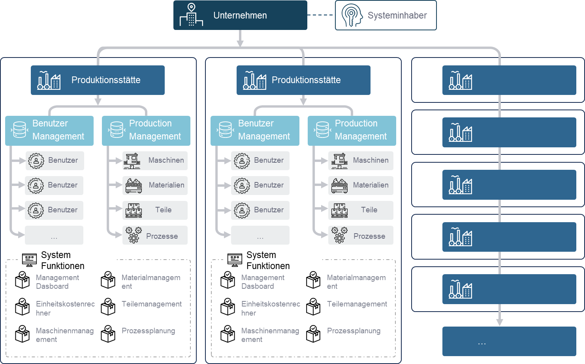
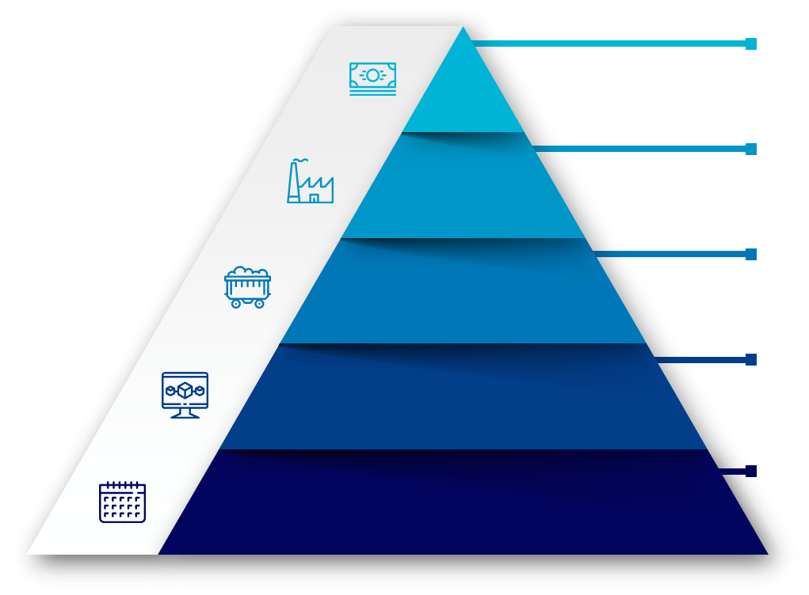

# LEAF — Additive Production Planning

LEAF ist eine webbasierte Anwendung für die Planung additiver Fertigung, insbesondere für das laserbasierte Pulverbettschmelzen. Sie verbindet Maschinenplanung, Materialübersicht und Bauteilkostenabschätzung in einer gemeinsamen Arbeitsumgebung.

Der Grundgedanke: Ein Bauauftrag hängt nicht nur von einer freien Maschine ab. Auch Bauteile, Materialverfügbarkeit, Prozessparameter sowie Vorbereitungs- und Nachlaufzeiten beeinflussen die Planung. LEAF betrachtet diese Informationen gemeinsam, damit Auslastung, Materialbedarf und Produktionsabläufe besser nachvollziehbar werden.

Das Projekt wird kostenfrei für Forschung, private und kommerzielle Zwecke angeboten. Es gibt keine kostenpflichtigen Tarife oder bezahlten Funktionsfreischaltungen.

## LEAF in Bildern

**Unternehmen und Standorte verbinden**

Benutzer, Maschinen, Materialien und Bauteile werden ihren Produktionsstandorten zugeordnet. So entsteht eine gemeinsame Struktur für Verwaltung und Planung.

**Von der Terminplanung zur Kostenabschätzung**

<table>
  <tr>
    <td rowspan="5" width="42%" valign="middle">
      
    </td>
    <td>
      <strong>PART COST ESTIMATION</strong> 
      An integrated cost tool enables you to think about your production starting with cost estimation, including the impact of process parameters.
    </td>
  </tr>
  <tr>
    <td>
      <strong>MACHINE CAPACITY PLANNING</strong> 
      By assigning components, processes, and materials to your machine, you can immediately see the annual machine capacity, both planned and used.
    </td>
  </tr>
  <tr>
    <td>
      <strong>MATERIAL DEMAND FORECAST</strong> 
      Specifying your annual part production volume allows you to plan your annual material demand.
    </td>
  </tr>
  <tr>
    <td>
      <strong>ANNUAL PART VOLUME</strong> 
      Our digital additive production planning gives you a good estimation of your annual part volume.
    </td>
  </tr>
  <tr>
    <td>
      <strong>PROCESS SCHEDULING</strong> 
      Setting process parameters and assigning part and material to the machine, you schedule your additive production
    </td>
  </tr>
</table>

Abbildungen aus der LEAF-Startseite; [Bildhinweise](https://github.com/additive-production-planning/.github/blob/main/profile/assets/README.md).

## Was lässt sich mit LEAF planen?

- **Maschinen und Kapazitäten:** Anlagen je Produktionsstandort verwalten und verfügbare, geplante und genutzte Maschinenzeiten gegenüberstellen.
- **Bauteile und Bauaufträge:** Bauteile, Materialien und Prozessparameter einer Maschine zuordnen und Aufträge zeitlich einplanen.
- **Bauzeit und Maschinenbelegung:** Berechnungen zur Bauzeit sowie zu Vorbereitungs-, Fertigungs- und Nachlaufzeiten für die Planung nutzen.
- **Materialbedarf:** Verfügbare und für Aufträge vorgesehene Materialmengen gemeinsam betrachten.
- **Produktionskennzahlen:** Im Dashboard einen Überblick über Maschinen, Bauteile, Auslastung und Jahreskennzahlen erhalten.
- **Bauteilkosten:** Den Einfluss von Maschinen-, Material- und Prozessdaten auf die geschätzten Herstellungskosten untersuchen.

Die Berechnungen unterstützen Planung und Bewertung. Ihre Ergebnisse hängen von den eingegebenen Daten und Modellannahmen ab und sollten vor dem praktischen Einsatz geprüft werden.

## Wie funktioniert der Einstieg?

1. **Konto anlegen und anmelden:** Die Anmeldung in LEAF erfolgt mit E-Mail-Adresse und Passwort.
2. **Unternehmen und Standort einrichten:** Neue Nutzer legen ihre organisatorische Struktur an oder treten über eine Einladung einem bestehenden Unternehmen bei.
3. **Stammdaten erfassen:** Maschinen, Materialien, Bauteile und die benötigten Prozessdaten hinterlegen.
4. **Produktion planen:** Bauteile und Material einer Maschine zuordnen, einen Startzeitpunkt wählen und die berechneten Zeiten für die Belegungsplanung verwenden.
5. **Planung überblicken:** Maschinenbelegung, Materialmengen und Produktionskennzahlen im Dashboard beziehungsweise in den Planungsansichten verfolgen.

Firmen- und Standortzuordnungen sowie Berechtigungen bestimmen den Datenzugriff. Die Passwörter werden als Hash gespeichert. Ein Passwort-Reset per E-Mail steht zur Verfügung, wenn der Betreiber den Mailversand eingerichtet hat.

Die Anmeldung in der Anwendung ist von GitHub unabhängig. Ein GitHub-Zugang wird für die Berechtigung auf die privaten Projekt-Repositories benötigt.

## Wie sind Anwendung und Datenhaltung aufgebaut?

| Bestandteil | Aufgabe |
| --- | --- |
| React-Weboberfläche | Dateneingabe, Dashboard und Planungsansichten im Browser |
| Node.js-/Express-Backend | Anmeldung, Berechtigungen, Datenzugriff und Koordination der Anfragen |
| MongoDB | Dauerhafte Speicherung von Benutzerkonten, Unternehmen, Standorten und Produktionsdaten |
| Python-/Flask-Formeldienst | Berechnung von Produktionszeiten, Materialbedarf und Kosten auf Anfrage |

Die Weboberfläche spricht mit dem Backend. Dieses liest und schreibt die Daten in MongoDB und ruft für Berechnungen den Python-Dienst auf. Der Formeldienst verwendet im Standardbetrieb keine eigene dauerhafte Datenbank. Für den Standardbetrieb ist keine zusätzliche SQL-Datenbank erforderlich.

### Lokaler Betrieb und Tests

Für die lokale Entwicklung startet LEAF eine MongoDB auf dem eigenen Rechner. Die eingegebenen Entwicklungsdaten bleiben nach dem Beenden der Anwendung erhalten und stehen beim nächsten Start wieder zur Verfügung. Eine Online-Datenbank ist dafür nicht erforderlich.

Automatisierte Tests verwenden eine separate temporäre MongoDB. Deren Testdaten werden nach dem Testlauf entfernt; die gespeicherten Entwicklungsdaten bleiben davon getrennt.

Für eine gehostete Installation kann der Betreiber eine eigene MongoDB bereitstellen. Der Speicherort der Anwendungsdaten richtet sich dann nach dieser Installation. GitHub dient der Verwaltung des Projekts, nicht als Datenbank für die eingegebenen Produktionsdaten.

## Lizenz

LEAF darf kostenfrei für Forschung, private und kommerzielle Zwecke genutzt werden. Eigene Beiträge zu Oberfläche, Anwendungsbackend und Dokumentation stehen unter der **MIT-Lizenz**, soweit die Rechteinhaber diese Rechte einräumen können. Copyright- und Lizenzhinweise müssen erhalten bleiben. Die [MIT-Lizenz dieser öffentlichen Dokumentation](https://github.com/additive-production-planning/.github/blob/main/LICENSE) gibt keine Rechte an privat betriebenen Berechnungsdiensten.

Der zentrale Berechnungsdienst und neue interne RL-/LLM-Bestandteile bleiben **proprietär** und sind von der MIT-Freigabe ausgenommen. Die kostenfreie Anwendung gewährt keinen Anspruch auf deren Quellcode oder Modelle. Zuvor wirksam eingeräumte Rechte bleiben bestehen. Näheres beschreibt der [Lizenzumfang](https://github.com/additive-production-planning/.github/blob/main/LICENSE-SCOPE.md). Die Software wird ohne Gewährleistung im gesetzlich zulässigen Umfang bereitgestellt; zwingende gesetzliche Haftung bleibt unberührt.

Drittanbieterbestandteile behalten ihre eigenen Lizenzbedingungen und werden nicht umgelizenziert.

Die [Nutzungsbedingungen des zentralen Berechnungsdienstes](https://github.com/additive-production-planning/.github/blob/main/CALCULATION-SERVICE-LICENSE.txt) sind ebenfalls öffentlich einsehbar. Sie enthalten die Erlaubnis zur kostenfreien Anwendungsnutzung und die Haftungsregelungen, ohne internen Quellcode oder Modelle freizugeben.

Diese öffentliche Seite beschreibt Funktionsweise und Lizenz. Quellcode, interne Betriebsanleitungen, Zugangsdaten und Produktionsdaten bleiben privat.
